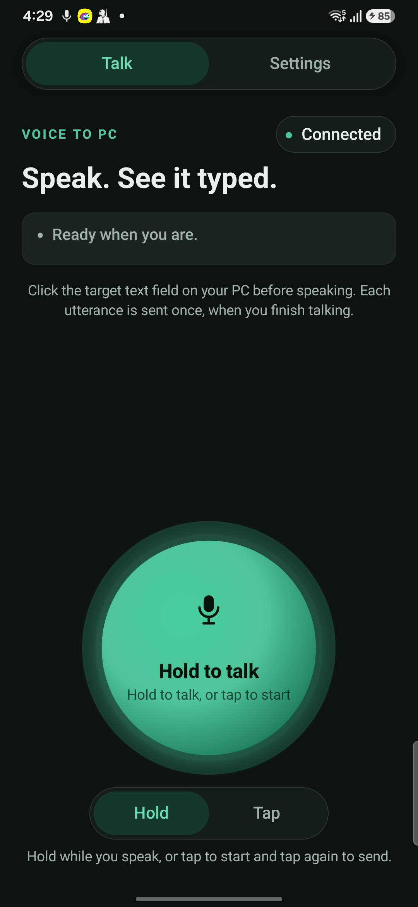
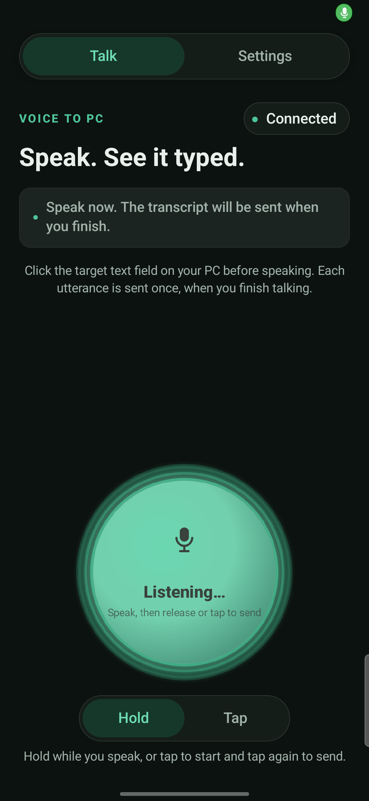
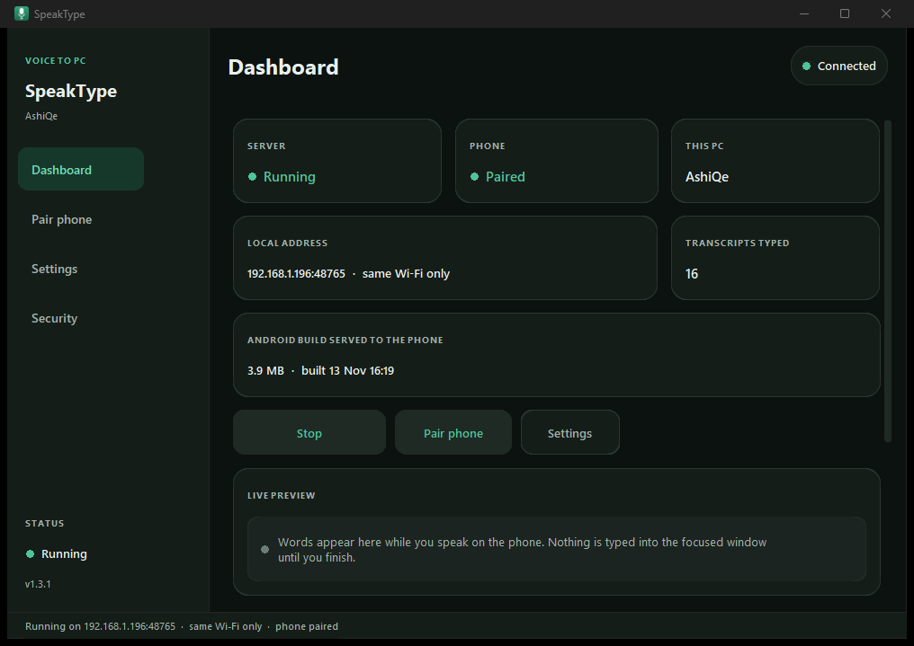
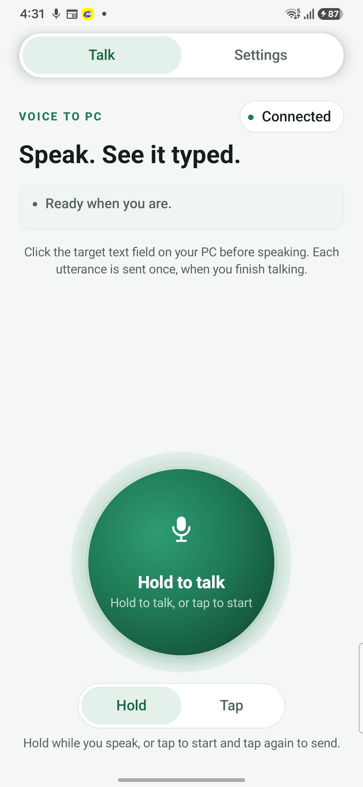
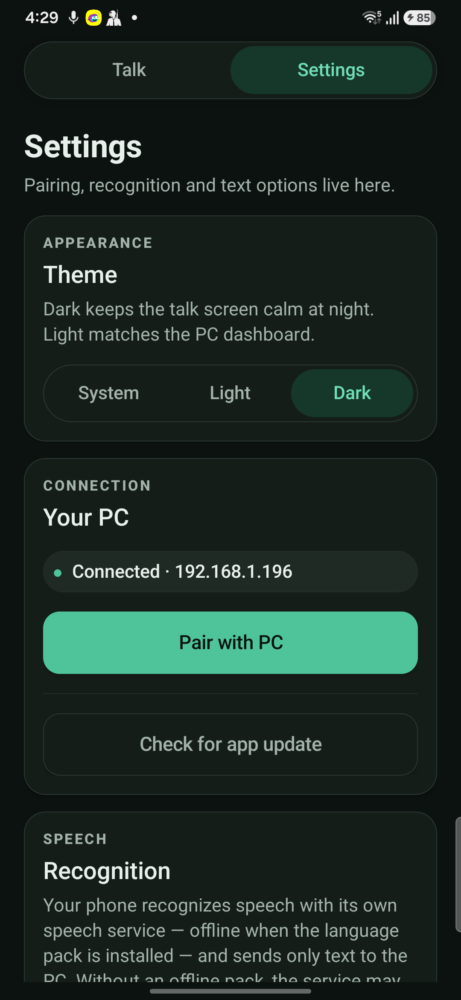
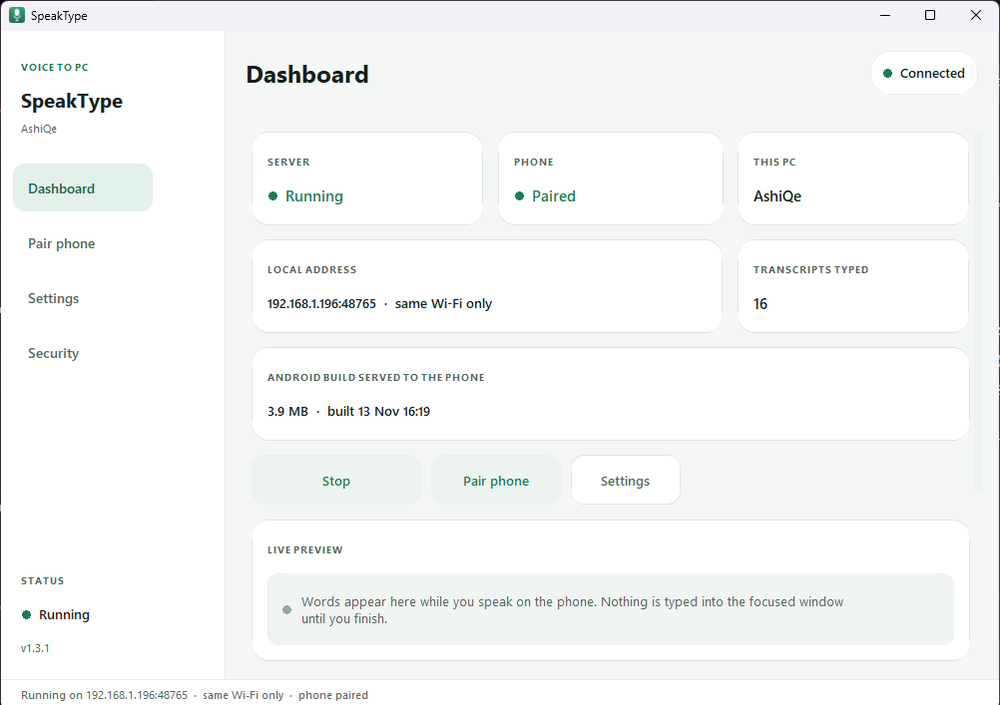
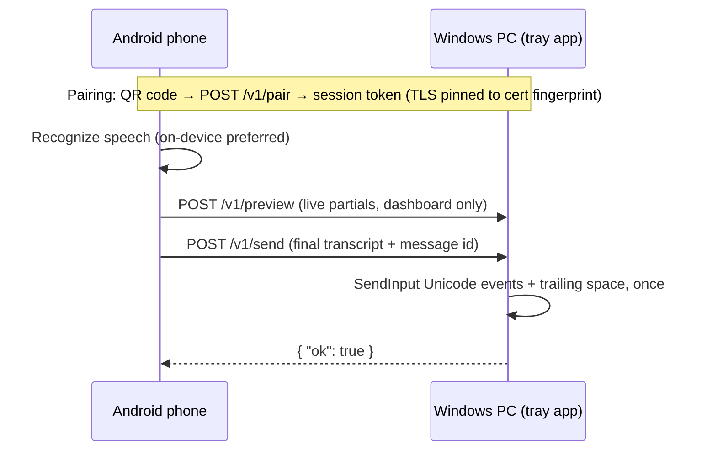

<div align="center">


# SpeakType

**Speak. See it typed.**

Dictate on your Android phone and watch the text appear in the focused window on your Windows PC — over your own Wi-Fi. No cloud relay, no clipboard, no account.

[](https://github.com/foysalkhan288-rgb/voice-to-pc/actions/workflows/ci.yml)
[](https://github.com/foysalkhan288-rgb/voice-to-pc/releases/latest)
[](LICENSE)
[](CONTRIBUTING.md)

[Install](#install) · [How it works](#how-it-works) · [Documentation](#documentation) · [Changelog](CHANGELOG.md)

</div>

## Screenshots

| Talk screen | Listening | Windows dashboard |
|---|---|---|
|  |  |  |
|  |  |  |

## Why SpeakType

- **Private by design.** Audio never goes to the PC. With an offline language pack installed, recognition runs entirely on the phone; only recognized text travels, over HTTPS pinned to your PC's certificate fingerprint, on your local network only.
- **No cloud, no account, no telemetry.** The developer runs no server. Pairing is a QR code between your two devices.
- **Well-behaved typing.** Unicode keyboard events into the focused window — no clipboard use, no focus stealing, and a refusal to type on secure desktops (sign-in, UAC).
- **Made for daily dictation.** Hold-to-talk or tap-to-talk, live preview on the PC, a trailing space after every insertion, Bengali / Banglish / English output, and one-tap in-app updates.

## Features

**Dictation**
- Hold to talk (finalize on release) or Tap mode (tap to start, tap to send).
- On-device speech recognition preferred; automatic online fallback only when the service cannot recognize offline.
- Output in Bengali script, Banglish (phonetic), or English; optional automatic Bangla/English switching on Android 14+ when the service supports it.
- Live partial transcripts in the PC dashboard; the final transcript is typed exactly once, with a trailing space so consecutive utterances never stick together.
- Unsent transcripts survive a dropped link in memory: retry or discard after reconnecting. No history is kept.

**Pairing & updates**
- QR-code pairing with TLS certificate pinning; the session token is DPAPI-encrypted on Windows and Keystore-encrypted on Android.
- The phone rediscovers the PC after a Wi-Fi IP change on the same subnet.
- In-app updates: an update card on the Talk screen (and a check in Settings) compares SHA-256 with the build served by your PC, or with GitHub Releases when unpaired. A downgrade guard refuses older builds.

**Windows tray app**
- Dashboard, Pair phone, Settings, and Security screens in the same design language as the phone app, dark and light.
- Live activity feed, typed-transcript counter, and Live preview panel.
- One-prompt Windows Firewall rule scoped to the app and its port; optional autostart; tray notifications; adjustable typing delay for apps that drop fast input.

## Install

Grab the latest build from [**Releases**](https://github.com/foysalkhan288-rgb/voice-to-pc/releases/latest): `SpeakType.exe`, `app-debug.apk`, `app-release.apk`, and `SHA256SUMS.txt`.

1. **Windows** — run `SpeakType.exe`. On first launch it registers autostart and asks once to allow phone connections through the firewall; answer **Yes** and confirm the administrator prompt.
2. **Android** (8.0+) — install `app-debug.apk` (allow installing unknown apps when asked) and open **SpeakType**.
3. **Pair** — on the PC open **Pair phone**, scan the QR code with the phone, then click the target text field on the PC and hold the big button to talk.

Both devices must be on the same Wi-Fi network. Prefer to build it yourself? See [Build from source](#build-from-source).

## How it works



The PC serves only local-network clients, caps request bodies, and persists delivered message ids so a retry never double-types. The wire contract is documented in [docs/API.md](docs/API.md); the component map in [docs/ARCHITECTURE.md](docs/ARCHITECTURE.md).

## Requirements

| | End users | Building from source |
|---|---|---|
| **Windows** | Windows 10/11 | Python 3.11+ |
| **Android** | Android 8.0+, microphone, camera for pairing | JDK 17+, Android SDK platform 36 |

## Build from source

**Windows** (from `windows/`, cmd or PowerShell):

```batch
setup.bat          :: creates .venv, installs deps, launches
run.bat            :: later runs, no console window
build-exe.bat      :: standalone dist\SpeakType.exe
.venv\Scripts\python.exe -m pytest tests/ -q
```

**Android** (from `android-app/`):

```batch
.\gradlew.bat assembleDebug
:: APK at app\build\outputs\apk\debug\app-debug.apk
```

Every icon (exe, tray, window, launcher) is generated from one drawing: after changing artwork run `windows/.venv/Scripts/python.exe tools/make_icons.py` from the repo root, then rebuild.

## Updating

- **Phone** — the Talk screen shows an update card when a newer build exists (served by your PC, or GitHub Releases when unpaired); tap it to install through the system installer. Settings → *Check for app update* does the same on demand.
- **Windows** — download the new `SpeakType.exe` from Releases and run it; your pairing and settings carry over.

Release mechanics, signing, and the versioning rules live in [RELEASING.md](RELEASING.md).

## Documentation

| Doc | Contents |
|---|---|
| [Architecture](docs/ARCHITECTURE.md) | Component map, state machines, storage, boundaries |
| [API](docs/API.md) | `/v1` endpoints, request/response shapes, error codes |
| [Privacy](docs/PRIVACY.md) | What leaves each device, what is stored, permissions |
| [Troubleshooting](docs/TROUBLESHOOTING.md) | Pairing, firewall, recognition, and typing fixes |
| [Changelog](CHANGELOG.md) | User-visible changes per version |
| [Releasing](RELEASING.md) | Versioning, CI, signing, release checklist |
| [Contributing](CONTRIBUTING.md) | Dev setup, tests, PR and commit conventions |
| [Security](SECURITY.md) | Private vulnerability reporting and scope |

## Troubleshooting

- **Phone can't see the PC** — allow the firewall banner on the Dashboard; confirm both devices are on the same Wi-Fi.
- **Nothing was typed** — click the target field first; secure desktops (sign-in/UAC) and some elevated apps refuse injected input.
- **PC got a new IP** — *Reconnect* on the phone usually finds it again on the same subnet.
- **Update says "App not installed"** — the offered build must be newer and signed with the same key; the app now guards against downgrades itself.

Full guide: [docs/TROUBLESHOOTING.md](docs/TROUBLESHOOTING.md).

## Contributing

Contributions are welcome — bug reports, feature ideas, and pull requests. Read [CONTRIBUTING.md](CONTRIBUTING.md) for setup and conventions, and the [Code of Conduct](CODE_OF_CONDUCT.md) for community expectations. Security issues go through [private advisories](SECURITY.md), never public issues.

## License

[MIT](LICENSE) — use it, fork it, ship it.